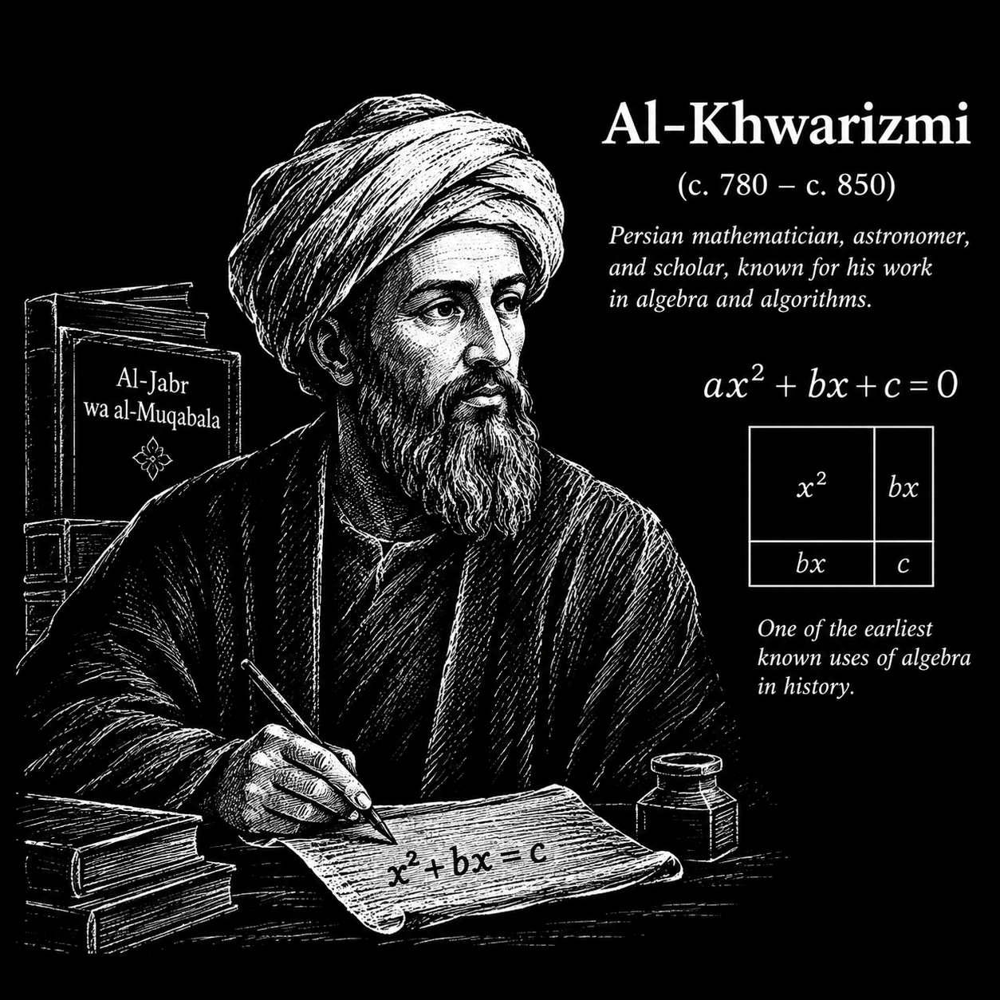
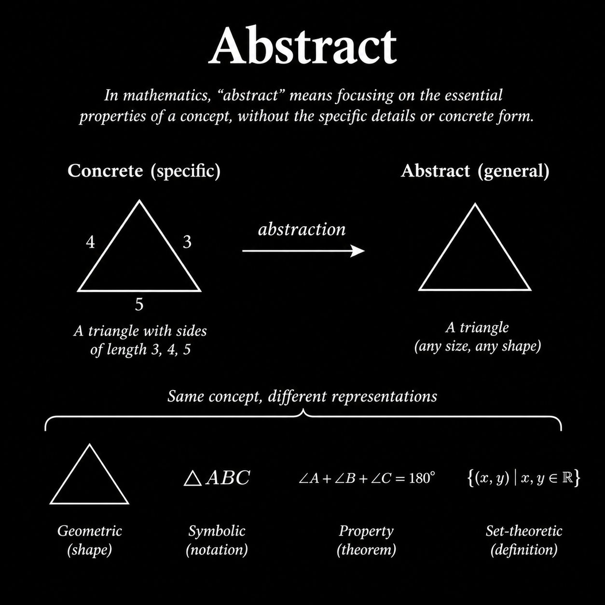
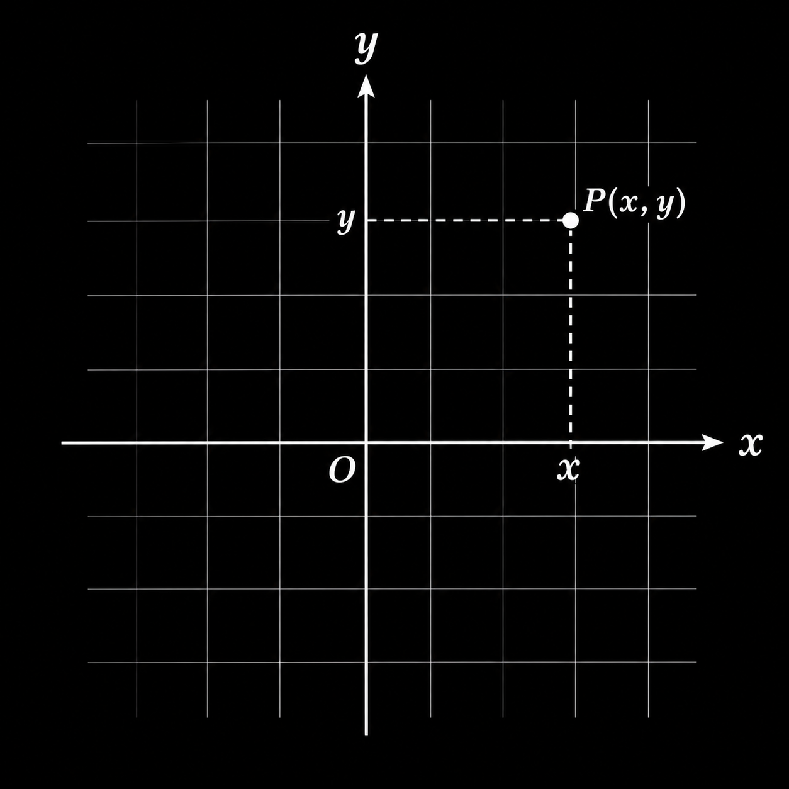
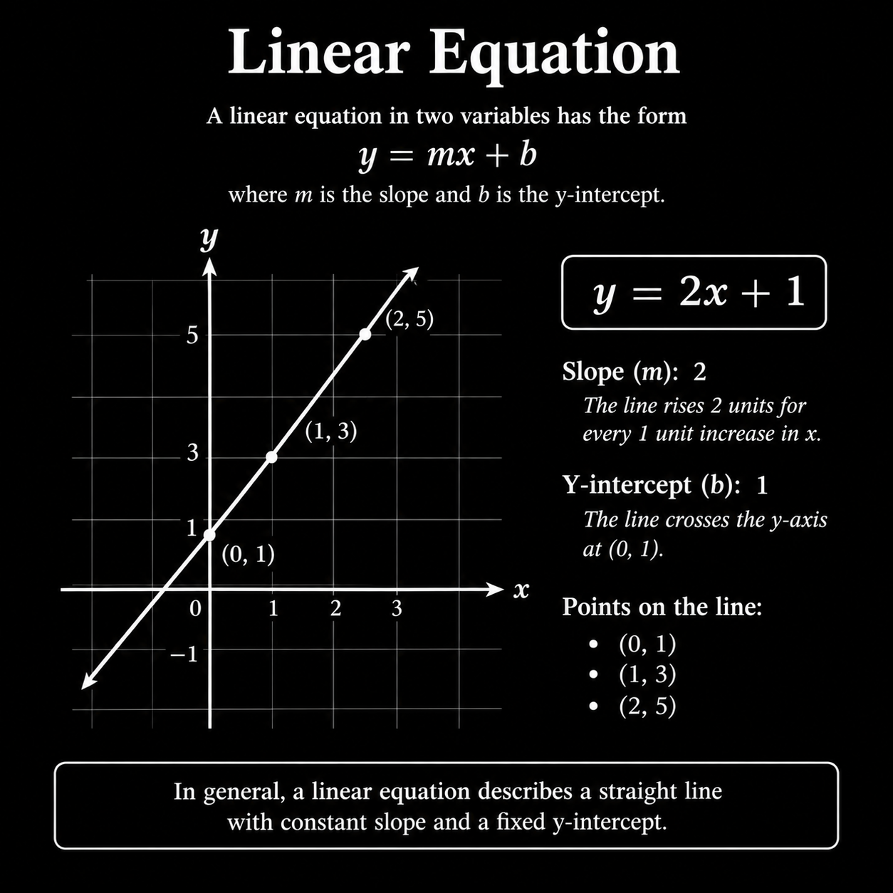
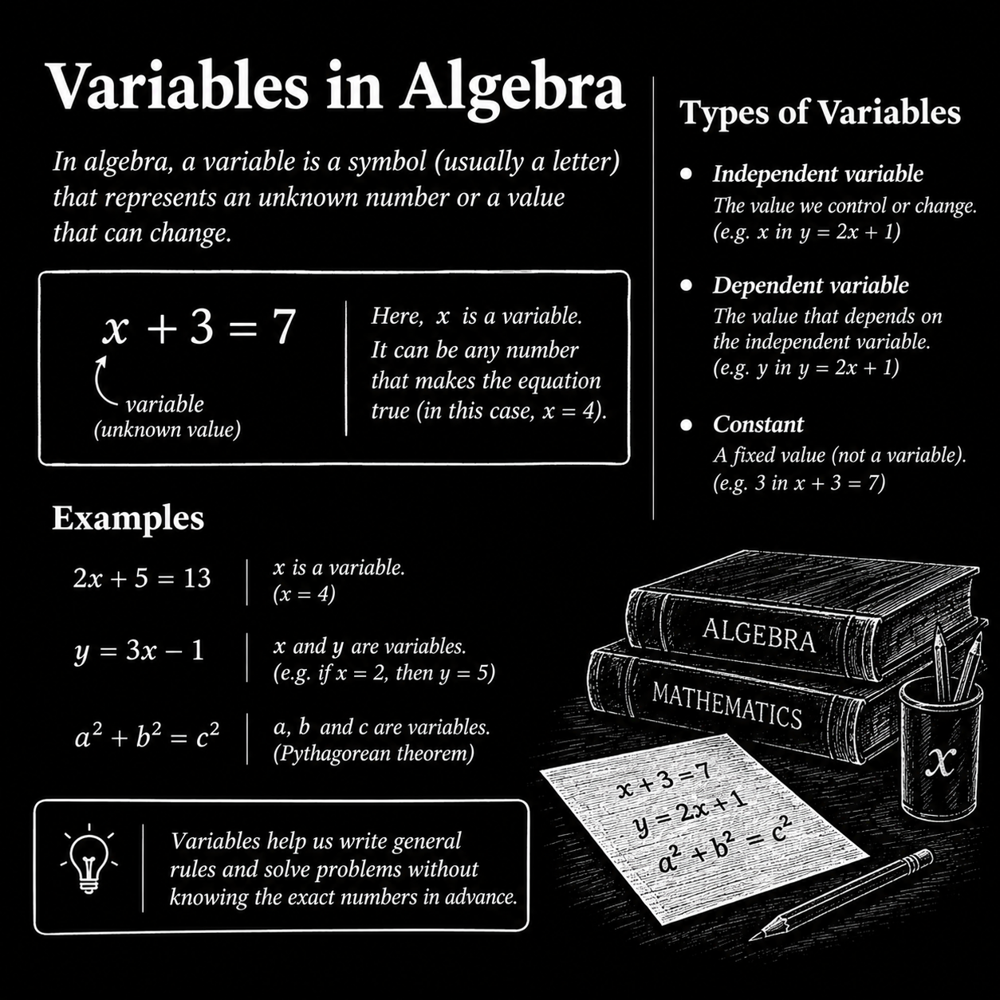
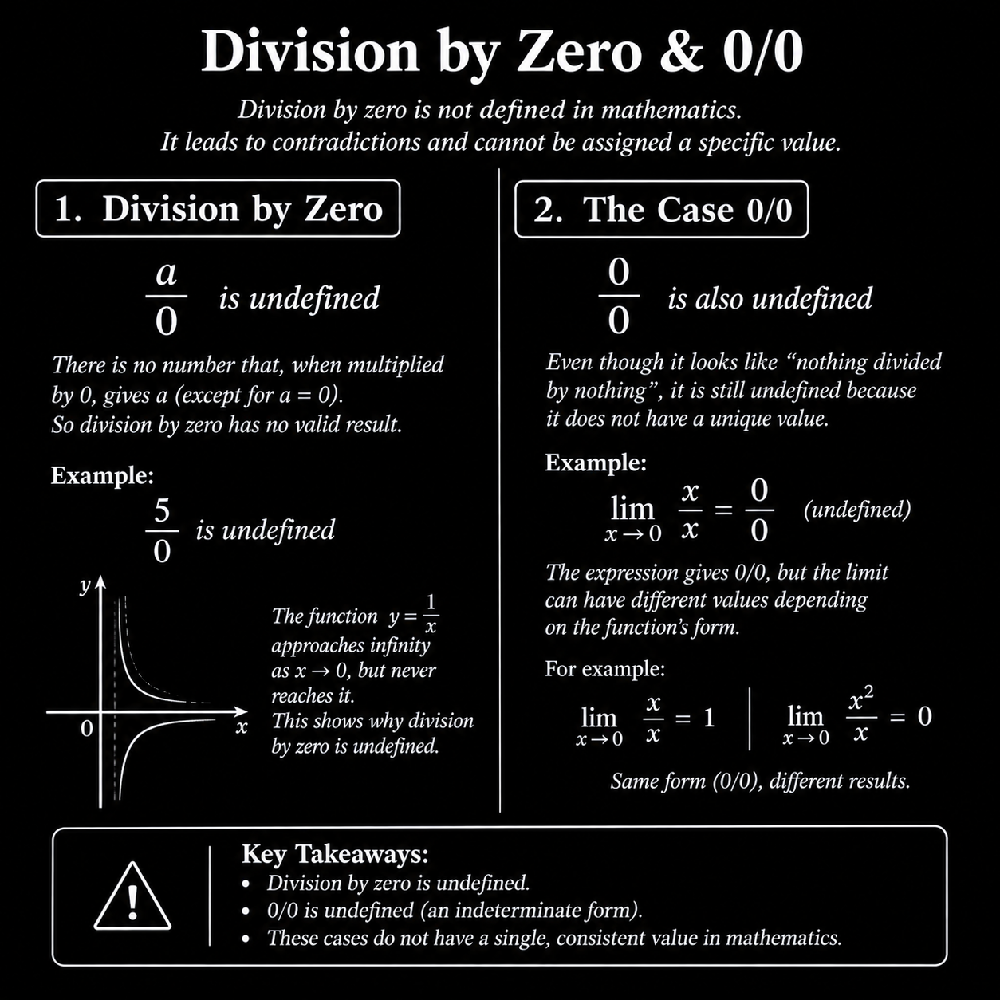

> 00-20: Foundation of Algebra.

## Introduction of Algebra:

### مقدمات و توضیحات:

جبر یکی از وسیع ترین شاخه های ریاضی است که به معنای، یکی سازی تکه های شکسته شده است.
 جبر شامل مباحث زیادی مثل حل معادلات مقدماتی تا مطالعه ی تجرید هایی چون گروه ها(Groups)، حلقه ها (Loops) و میدان ها(Field) است. 

$$X = \frac{-b + \sqrt{b^2 - 4ac}}{2a}$$
در معادله ی مربعی بالا نماد های X، b، a، c همه متغیر هستند، و میتواند هر مقداری باشد، البته مقدار عددی.

جبر روش هایی برای نوشتن فرمول ها و حل معالات ارایه می دهد که بسیار ساده تر و واضح تر از روش های قدیمی است که همه چیز را برحسب کلمات یا شکل ها می نوشتند.

علم جبر توسط ریاضیدان ایرانی خوارزمی پایه گذاری شد، خوارزمی به پدر علم جبر معروف است.

    

---
 

> Video 01-20: Abstract

### انتزاع | Abstract: 

کلمه ی Abstract یعنی به جای تمرکز روی یک شی یا عدد خاص روی ساختار قوانین و رابطه های کلی تمرکز کنیم. این نگاه کلی تر Abstract است.

در ریاضیات یعنی حذف جزییات غیر ضروری و تمرکز روی الگو و ساختار مشترک بین چیز های مختلف.

$$ 2 + 3 = 5 $$
$$ a + b = b + a $$

در عبارت های بالا، عبارت اول با اعداد ثابت نوشته شده است، عبارت دوم نسخه ی Abstract شده ی عبارت اول است که این قانون را نشان می دهد که جابجایی در جمع نتیجه را تغییر نمی دهد.

برای مثال می توان عدد 5 را به شکل های مختلفی نشان داد، به شکل چوب خط، اعداد رومی، اما منظور همان عدد 5 است.

    

---
 

> Video 02-20: Linear Equation and Cartesian Coordinate

### مختصات دکارتی | Cartesian Coordinate:

برای این که یک نقطه را روی نمودار های x، y مشخص کنیم از مختصات دکارتی یا (Cartesian Coordinate) استفاده می کنیم.

$$ (X, Y) $$

برای مشخص کردن هر نقطه در روی نمودار اول X و سپس Y را می نویسیم، مانند نمونه بالا و تصویر پایین.

    

### معادلات خطی | Linear Equation: 

معادله ی درجه یک یا معادله ی خطی معادله ای است که با تقییرات X مقدار Y به شمل ثابتی رشد می کند، و می توان گفت شیب این خط در همه ی نقاط یکسان است و به شکل یک خط سعودی(مثبت) یا نزولی(منفی) در  می آید. در قسمت پایین یک نمونه ی ساده از معادله ی خطی می بینید:

$$ Y = mX + b $$
$$ Y = 2X + 1 $$

    

> Video 04-20: Varibles in Algebra

### متغیر | Variable:

در جبر و ریاضیات برای اینکه یک جمله یا یک عبارت را به شکل انتراعی(Abstract) بنویسیم از متغیر ها استفاده می کنیم. متغیر ها نماد ها یا حرف هایی هستند که میتوانند با هر عدد یا مقداری پر شوند، متغیر ها انواع مختلفی دارند مانند، متغیر های وابسته و غیر وابسته، و ثابت ها که آنها را در قسمت پایین توضیح می دهیم.

$ x = 2 $ | $ y = 17 $ | $ b = 12.5 $

### متغیر های غیر وابسته | Independent Variable:

متغیر هایی هستند که هیچ وابستگی به سایر عدد ها و متغیر های دیگر ندارند، این متغیر ها یه می توانند خودشان باعث بوجود آمدن متغیر های وابسته بشوند.

$$ y = 4(x) + 5 $$

برای مثال در عبارت بالا متغیر $x$ یک متغیر غیر وابسته است.

 

### متغیر های وابسته | Dependent Variable:

این دسته از متغیر های متغیر های مستقل و خودساخته نیستند و از وابسته به سایر متغیر ها هستند، بسته به معادله ها و عبارت ها از جمع، ضرب، تقسیم و ... سایر متغیر های وابسته یا مستقل بدست می آیند.

$$ (y) = 4x + 5 $$

در مثال بالا می توان از متغیر $y$ به عنوان یک متغیر وابسته یاد کرد چون از مقادیر دیگری در معادله بدست می آید، در این مثال متغیر $x$ و ثابت های $4$، $5$ باعث بوجود آمدن متغیر $y$ شده اند.

 

### ثابت ها | Constant:

ثابت ها همانطور که از اسمشان پیدا هست مقادیر ثابتی هستند که هیچگونه تغییری نمی کنند، به طور کلی دو نوع ثابت وجود دارد ثابت های عددی که همان عدد های حقیقی و پیوسته هستند و ثابت های تعریف شده مانند عدد پی($π$) یا عدد نپر($e$)، که مقادیری هستند ثابت برای اینکه بتوان به عنوان یک قرارداد در ریاضیات استفاده شود. 

$$ y = (4)x + (5) $$

در مثال بالا مقادیر 4 و 5 اعداد ثابتی هستند که در معادله هیچگونه تغییری نمی کنند. (دیگر متغیر نیستند تا عددی بجز 4 یا 5 باشند), و نوع این ثابت ها از ثابت های عددی یا پیوسته است.

$$ A = (\pi) * r^2 $$

و همینطور در مثال بالا یک ثابت ریاضی از نوع ثابت های تعریف شده داریم که آن عدد $\pi$ است که در ریاضیات معادل عدد 3.14 است

    

---
 

> Video 06-20: Simplify the Equation Rules

### قوانین ساده سازی عبارت ها | Simplify Rules:

در جبر برخی از عبارت ها را می توان تا جای که میشود به صورت ساده تر نوشت، برای ساده تر شدن و قابل فهم تر شدن این قسمت رو با مثال های بیشتر جلو میریم.

برای مثال اگر 4 تکه پرتقال را داشته باشیم و 4 تکه سیب، می تونیم اون چهار تکه سیب رو به هم بچسبونیم و اون چهار تا پرتقال هم به هم، ولی نمی تونیم تکه های پرتقال رو به تکه های سیب بچسبونیم چون با هم همخونی ندارند در عبارت ها نیز همین هست، گاهی وقت ها عبارت ها کثیف و به صورت پیچیده نوشته شدن اما میتونیم اونها رو ساده تر کنیم البته تا جایی که میشه و در چارچوب قوانین.

$$ Apple + Apple + Apple + Apple + Orange + Orange + Orange + Orange $$
$$ 4_{Apple} + 4_{Ornage} $$

 

مثال دیگری از ساده سازی:

$$ 23 + 2y - 1x + 3y - 4x $$
$$ 23 + 5y - 5x $$

 

یه مثال با پیچیدگی بیشتر:

$$7(3y-5)-2(10+4y) = 21y - 35 - 20 - 8y = 13y - 55 $$

---
 

> Video 18-20: Division by 0 and 0/0 | Undefined

### تعریف نشده | Undefined: 
در ریاضیات یک سری مسایل و عبارت ها چون مقدار واضح و درستی ندارند را تعریف نشده می گوییم.

در بخش زیر چند نمونه تعریف نشده آوردیم.
$$ \frac{a}{0} = Undefined $$
یا وقتی تقسیم 0 بر 0 را میخواهیم:
$$ \frac{0}{0} = Undefined $$

    

