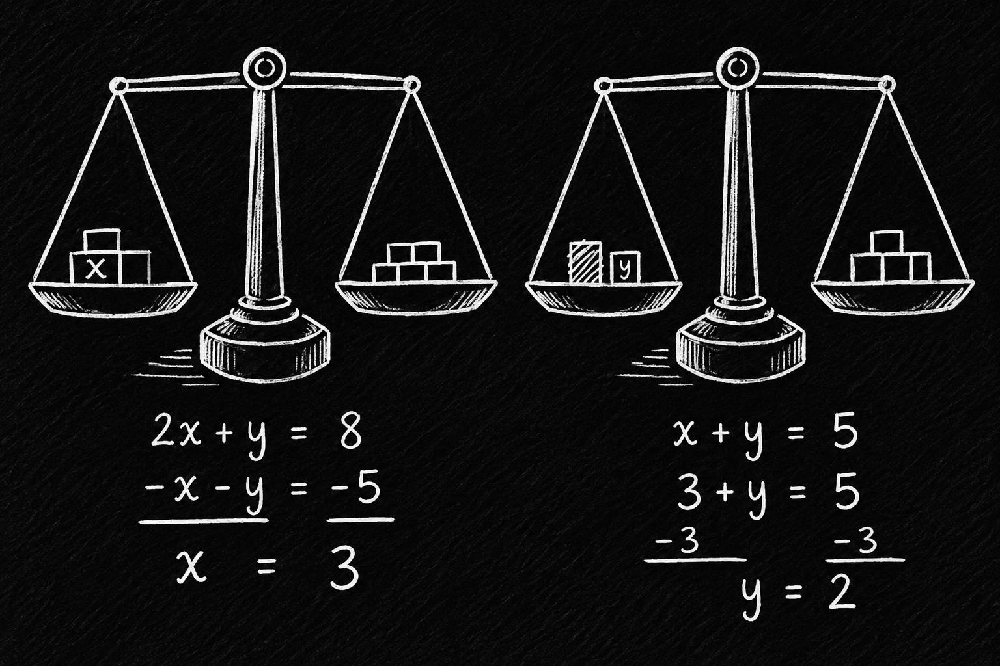
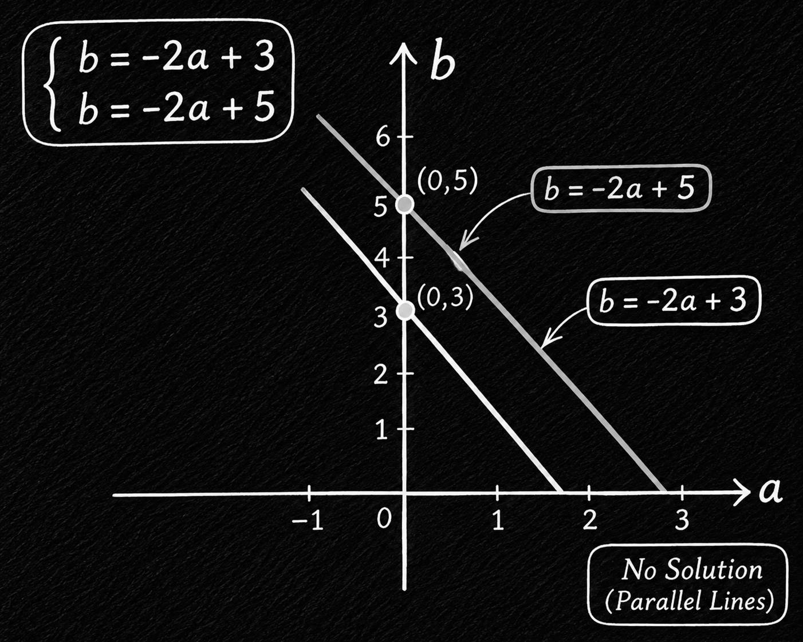

## 100-120: Solving the System of Linear Equations by Elimination and Substitution

### حل دستگاه های معادله خطی با حذف | Solving the System of Linear Equations by Elimination:

یه راه حل کردن دستگاه ها این بود که نقاط معادله رو پیدا کنیم و پلاتش کنیم، و نقطه ای که خط ها هم رو قطع میکردن میشد پاسخ سوال ما، یه راه دیگه هم این بود که یکیشون رو به شکل و فرم slope-intercept بنویسیم. اما الان با یه راه دیگه میتونیم این دستگاه ها رو ساده حل بکنیم و مقدار دو مجهول رو بدست بیاریم.

 

توی این روش ما یک معادله ی توی دستگاه رو از اون یکی کم میکنیم، اما به شکلی که بتونیم یکی از مجهول ها رو حذف کنیم دلیل اسمش هم همینه، حل کردن دستگاه معادله خطی با استفاده از حذف کردن.

$$ \begin{cases} A_1x + B_1y = C_1 \\ A_2x + B_2y = C_2 \end{cases} $$

$$ (A_1x - A_2x) + (B_1y - B_2y) = (C_1 - C_2) $$

این عبارت به شکل انتزاعیش بود حالا بریم با اعداد مثال بزنیم.

$$ \begin{cases} x - 4y = -18 \\ -x + 3y = 11 \end{cases} $$

$$ (x - x) + (-4y + 3y) = (-18 + 11) $$

$$ \frac{-y}{-1} = \frac{-7}{-1} $$

$$ y = 7 $$

حالا برای x رو بدست بیاریم.

$$ x - 4(7) = -18 $$

$$ x - 28 = -18 $$

$$ x = 10 $$

پس پاسخ دستگاه میشه:

$$ (10, 7) $$

    

---

### قوانین حذف مجهول در دستگاه معادله | Rule of the Elimination in System:

توی جبر و ساده سازی عبارت ها قوانینی رو داشتیم، و باید طبق این قوانین تعریف شده رفتار میکردیم تا به نتیجه درست برسیم. توی دستگاه های معادلات خطی هم زمانی که میخواید مجهول رو حذف کنید باید همون کاری که برای حذف مجهول انجام میدی برای سایر متغیر ها و ثابت ها هم انجام بدید، در غیر این صورت دیگه نمیتونیم بهش معادله بگیم و به یک نامعادله تبدیل میشه.

 

بریم با مثال این رفتار رو ببینیم: معلم به دانشجو اول و دانشجو دوم یک دستگاه معادله میده، و دانشجو ها این معادلات رو به شکلی که میخوان تغییرش میدن، کدوم یکی از این دانشجو ها درست عبارت ها رو تغییر میده به شکلی که جواب با معادله ی معلم یکی باشه.

 

معادله ی معلم:

$$ \begin{cases} x + 2y = -1 \\ -4x + 5y = 1 \end{cases} $$

معادله ی دانشجوی اول:

$$ \begin{cases} x + 2y = -1 \\ -3x + 7y = 0 \end{cases} $$

معادله ی دانشجوی دوم:

$$ \begin{cases} -4x + 5y = 1 \\ -8x - 16y = 8 \end{cases} $$

توی معادله ی دانشجوی اول مقدار عبارت اول همون هست اما عبارت دوم تغییر کرده، کاری که کرده این بوده که توی دستگاه معادله ی معلم معادله ها رو باهم ترکیب کرده. پس کار درستی رو انجام داده یعنی این شرایط رو برای همه ی عملوند ها در نظر گرفته.

$$ (x - 4x) + (2y + 5y) = (-1 + 1) $$
$$ -3x + 7y = 0 $$

دانشجوی دوم هم کاری که کرده این بوده که عبارت دوم رو ثابت نگهر داشته و ترتیب عبارت ها رو جابجا کرده، و اون یکی عبارت رو در -8 ضرب کرده.

$$ -8(x + 2y = -1) $$

$$ -8x - 16y = 8 $$

این هم درسته چون برای همه ی عملوند ها این ضریب در نظر گرفته شده. این شکل تغییر دادن معادلات باعث میشه مقیاس اون ها تغییر کنه، یعنی شیب خط و عرض از مبدا همون مقادیره اما مقیاسشون فرق میکنه پس میشه گفت که راه حل و نتیجه همونه.

 

ولی کی این معادلات به شکل نادرست تغییر داده میشن، اگر که شرایط و اون ترم رو برای همه ی عملوند ها در نظر نگیرید میشه گفت نامعادله به شکل نادرستی تغییر داده شده.

مثلا مثال پایین:

$$ -4x + 5y = (1 * 8) $$

$$ -4x + 5y = 8 $$

---

### استدلال های دستگاه های معادله خطی | Reasoning of System of Linear Equation:

همه ی اون قوانین و استدلال هایی که بالاتر به اون پرداختیم برای بدست آوردن جواب این دستگاه های خطی نیازه، اما واقعا چه اتفاقی میفته و چجوری این جواب ها بدست میان؟؟؟

 

در واقع وقتی ما میگیم معادله رو حل کردیم به این معنیه که تونستیم این معادله رو به قدری ساده کنیم که فهم اون برای ما ساده تر باشه، میشه گفت در هر مرحله ما داریم این معادله رو بازنویسی میکنیم.

 

مثلا:

$$ (2x = 10) \rightarrow (x = 5) $$

$$ (2x = 8) \rightarrow (x = 4) $$

یعنی معادله های چپ همون معادله ی سمت راست هستن که ساده و بازنویسی شدن. به خاطر همین هم معادله اسمشون هست، چون معادل همدیگه هستن.

 

همین شکل هم در دستگاه های معادله خطی داریم:

$$ \begin{cases} 2x + y = 8 \\ x + y = 5 \end{cases} \rightarrow \begin{cases} 2x + y = 8 \\ (-2)(x + y) = (-2)5 \end{cases}$$

$$ \begin{cases} 2x + y = 8 \\ -2x + -2y = -10 \end{cases} \rightarrow \begin{cases} 2x + y = 8 \\ y = 2 \end{cases}$$

$$ \begin{cases} 2x + 2 = 8 \\ y = 2 \end{cases} \rightarrow \begin{cases} x = 3 \\ y = 2 \end{cases}$$

هر مرحله معادله ساده تر و بازنویسی شده ولی باز هم همون معادله هستش.

---

### سیستم های ناسازگار | Inconsistent Systems:

بزارید این شکل از معادلات رو با مثال جلو ببریم. فرض کنید که دستگاه معادله زیر رو داریم:

$$ \begin{cases} 2x + y = 3 \\ 6x + 3y = 15 \end{cases} $$

حالا تلاش کنیم که یکی از مجهول ها رو حذف کنیم:

$$ \begin{cases} -3(2x + y = 3) \rightarrow -6x - 3y = -9\\ 6x + 3y = 15 \end{cases} $$

$$ \begin{cases} -6x - 3y = -9 \\ 6x + 3y = 15 \end{cases} $$

حالا اگر این جفت معادله رو با هم ترکیب کنیم مشکل عجیبی پیش میاد، همه ی مجهول های ما با هم حذف میشن:

$$ 0 = 6 $$

ولی این جوابی که بدست آوریدیم تعریف نشده است. برای اینکه ببینیم مشکل اصلی چیه میتونیم این معادلات رو به فرم slope-intercept بنویسیم و بعد اون رو پلات کنیم.

$$ \begin{cases} 2x + y = 3 \\ 6x + 3y = 15 \end{cases} \rightarrow \begin{cases} y = -2x + 3 \\ 3y = -2x + 5 \end{cases} $$

میبینیم که شیب هر دو معادله یکسانه ولی عرض از مبدا اون ها با هم تفاوت داره، یعنی این که خط ها هیچوقت با همدیگه برخورد نمیکنن، به خاطر همین میشه گفت این معادله هیچ پاسخی نداره و یک معادله ی ناسازگاره.

    

