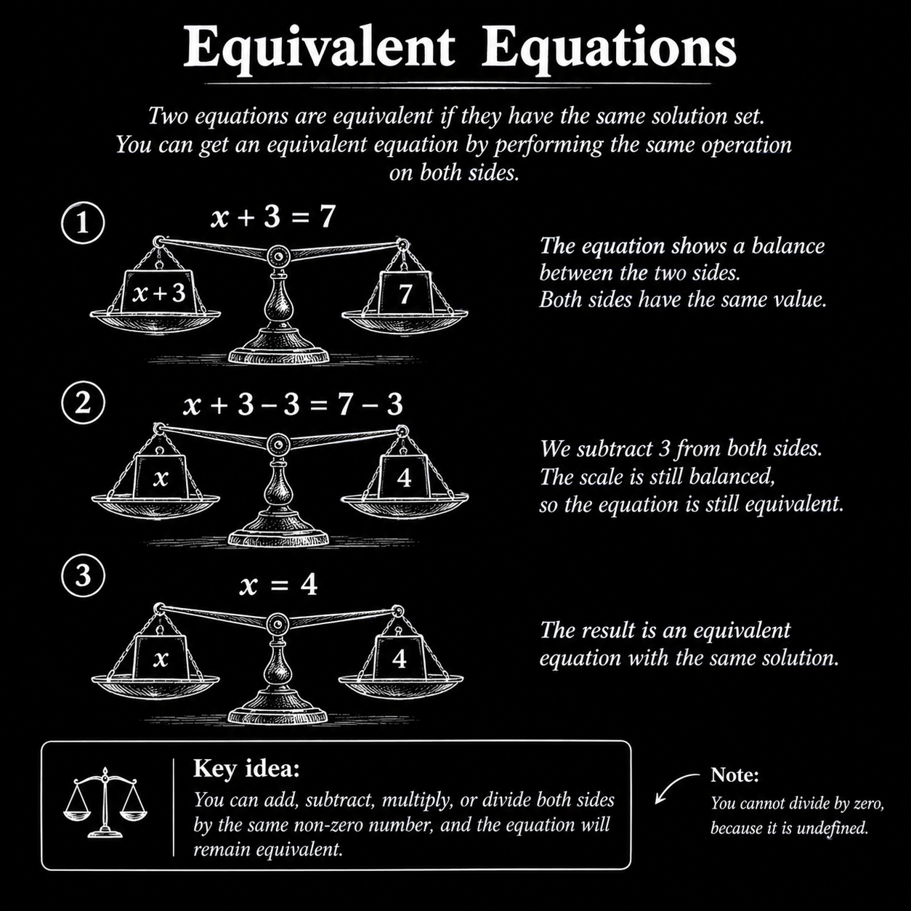
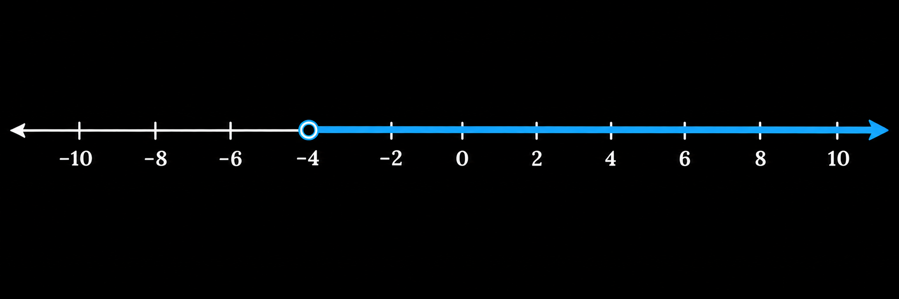
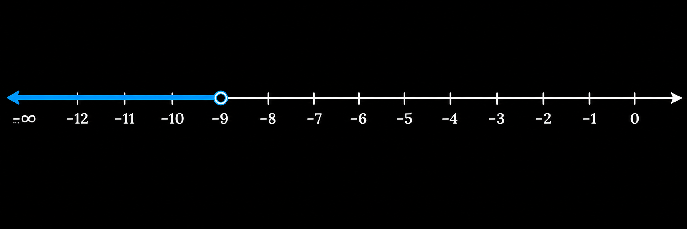
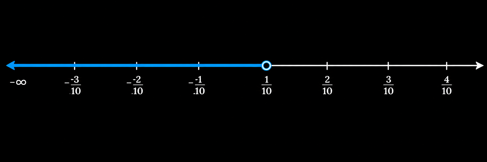
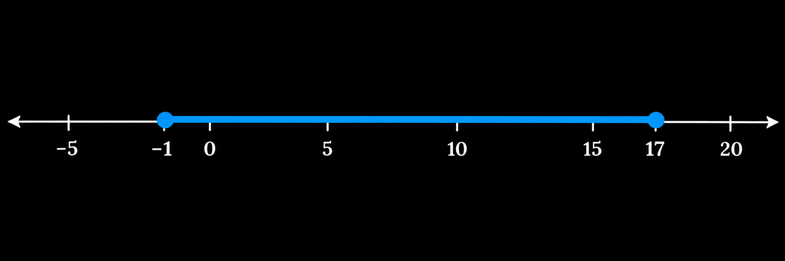
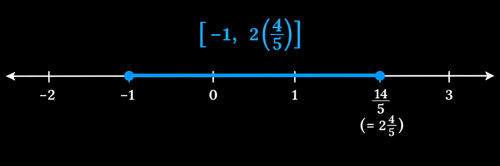
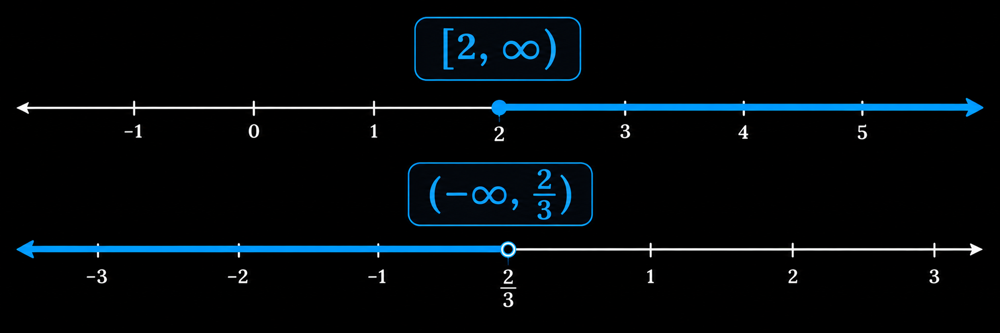

## 20-40: Simple and Compound, Equivalent and Inequalities

> Simple Equivalent Equation's: Single (x)

### معادله های تک مجهولی متوازن:
اسم عجیبیه ولی مفهوم کاملا سادست، در تمامی معادلات بخشی از معادله نامعلوم یا مجهول هستش، هدف ما پیدا کردن اون آیتم یا آیتم های مجهول هست. وقتی میگیم معادله ی متوازن یعنی دو سمت معادله، سمت چپ و سمت راست مقدار یکسانی رو دارن. پس در این معادله ها اگر مجهول ها را درست بدست بیاریم میتونیم این ادعا رو بکنیم که دو سمت مقدار یکسانی داره.

    

### معادله اول: 

$$ \frac{3}{4}x+2 = \frac{3}{8}x-4 $$
$$ 8(\frac{3}{4}x+2) = 8(\frac{3}{8}x-4) $$
$$ 6x + 16 = 3x - 32 $$
$$ \frac{3x}{3} = \frac{-48}{3} $$
$$ x = -16 $$

### معادله دوم:

$$ -9-(9x-6) = 3(4x+6) $$
$$ -9-9x+6 = 12x+18 $$
$$ -9x-3 = 12x+18 $$
$$ -21x-3 = 18 $$
$$ \frac{-21x}{-21x} = \frac{21}{-21} $$
$$ x = -1 $$

### نامعادله ها و شرایط حساس:
بعضی وقت ها بعد از ساده کردن معادله میرسیم به یه شرایطی که عجیب غریب میشه مثلا جفت طرف ها یک عدد ثابت بدون هیچ مجهولی میمونه، مثلا:

$$ 2x = 2x $$
$$ 12 = -42 $$

یا یکمی پیچیده تر:

$$ -11x+4 = -11x-11 $$
$$ 4 = -11 $$

توی این معادله ها و این شرایط هیچ کاری نمیشه کرد، x جادویی نیست که بتونه دوتا عدد نامساوی رو متوازن کنه. پس توی این معادله ها میتونیم بگیم معادله هیچ جوابی نداره.

---
 

> Compound Equivalent Equation's: Multiple Unknown(x, y, z, ...)

### معادله های چند مجهولی متوازن:
توی این سری معادله ها بر خلاف تک مجهولی ها چند مجهول و نامعلوم توی عبارت هامون داریم برای مثال (x, y, a, b, ...)، توی اینجا یکمی تفاوت با تک مجهولی داریم توی حل کردن.

### معادله اول:

$$ ax+3x = bx+5 $$
$$ ax+3x-bx = 5 $$
$$ \frac{x(a+3-b)}{(a+3-b)} = \frac{5}{(a+3-b)} $$
$$ x = \frac{5}{a+3-b} $$

### معادله دوم:

$$ a(5-x) = bx-8 $$
$$ 5a-ax = bx-8 $$
$$ -ax-bx = -8-5a $$
$$ \frac{x(a+b)}{(a+b)} = \frac{8+5a}{(a+b)} $$
$$ x = \frac{8+5a}{(a+b)} $$

---
 

> Inequalities Equation's: Other side bigger than other side 

### معادله های نامتوازن:
معادله های نامتوازن از اون دسته معادله هایی که یه طرف از اون طرف ممکنه کمتر یا بیشتر باشه، یعنی بجای اینکه دو طرف ثابت باشن یک سمت بزرگتره یا کوچیکتر. توی این معادله ها یه تفاوت اساسی وجود داره، به جای = از > یا < استفاده می کنیم.

### معادله اول:

$$ -3p-7 < p+9 $$
$$ -4p-7 < 9 $$
$$ \frac{-4p}{-4} < \frac{16}{-4} $$
$$ p > -4 $$
$$ (-4, \propto) $$

    

### معادله دوم: 

$$ 4x+3 < -1 $$
$$ \frac{4x}{4} < \frac{-4}{4} $$
$$ 5x > 8x+27 $$
$$ \frac{-3x}{-3} > \frac{27}{-3} $$
$$ x < -9 $$
$$ (-\propto, -9) $$

    

### معادله سوم:

$$ 8x-5(4x+1) \geq -1+2(4x-3) $$
$$ 8x-20x-5 \geq -1+8x-6 $$
$$ -12x-5 \geq -7+8x $$
$$ -20x-5 \geq -7 $$
$$ \frac{-20x}{-20} \geq \frac{-2}{-20} $$
$$ \frac{-20x}{-20} \leq \frac{2}{20} $$
$$ x \leq \frac{1}{10} $$
$$ (-\propto, \frac{1}{10}) $$

    

---
 

> Compound Inequalities Equation's: (AND, OR)

### معادله های نامتوازن ترکیبی:
در این معادله ها ترکیبی از چند معادله را دارم که باید هر یک را به صورت جدا حساب و ساده سازی کنیم. این معادلات به دو شکل AND و OR هستند. در AND مجهول ما عضوی از یک بازه ی عددی است، و در OR مجهول ما می تواند یا در بازه عددی اول باشد یا در بازه عددی دوم.

### معادله های نامتوازن AND:
همان طور که در بالا اشاره کردیم در این معادله ها دنبال پیدا کردن یک بازه(Range) پیوسته هستیم. و x یا مجهول معادله ی ما می تواند عضوی از آن بازه پیوسته عددی باشد. برای مثال:

$$ x \epsilon (-1, 5] $$

### معادله اول:

$$ -5 \leq x-4 \leq 13 $$
$$ (-5 \leq x-4) and (x-4 \leq 13) $$
$$ -1 \leq x \leq 17 $$
$$ [-1, 17] $$

    

### معادله دوم:

$$ -12 < 2-5x \leq 7 $$
$$ (-12 < 2-5x) and (2-5x \leq 7) $$
$$ \frac{-14}{-5} < \frac{-5x}{-5} \leq \frac{5}{-5} $$
$$ -1 \leq x < 2\frac{4}{5}  $$
$$ [-1, 2\frac{4}{5}) $$

    

 

> OR Compound Inequalities Equation's:

### معادله های نامتوازن OR:
در این معدله ها ما میتوانیم دو بازه را داشته باشیم که x یا مجهول ما به طور واحد فقط یا در بازه اول باشد یا در بازه دوم. برای مثال:

$$ (x \epsilon (-\propto, 5)) or (x \epsilon [10, \propto)) $$

### معادله اول:

$$ (4x-1 \geq 7)or(\frac{9x}{2} < 3) $$
$$ (4x-1 \geq 7)or(\frac{2}{9}\cdot\frac{9x}{2} < 3 \cdot \frac{2}{9}) $$
$$ (\frac{4x}{4} \geq \frac{8}{4}) or (x < \frac{6}{9}) $$
$$ (x \geq 2) or (x < \frac{2}{3}) $$
$$ [2, \propto) or (-\propto, \frac{2}{3}) $$

    

> AND no-solution's rule:

### نامعادله های AND:
در برخی از معادله های AND می یبنیم که این معدلات به ما یک بازه واحد پیوسته نمی دهد، یک جورایی مانند OR عمل می کند، در این گونه معادلات می تونیم بگیم که. این معاده هیچ جوابی ندارد. برای مثال در معادله زیر:

$$ (3y+7 < 2y) and (4y+8 > -48) $$
$$ (y+7 < 0) and (4y > -56) $$
$$ (y < -7) and (\frac{4y}{4} > \frac{-56}{4}) $$
$$ (y < -7) and (y > -14) $$
$$ (-\propto, -7)and (-14, \propto)$$
$$ no-solution $$
