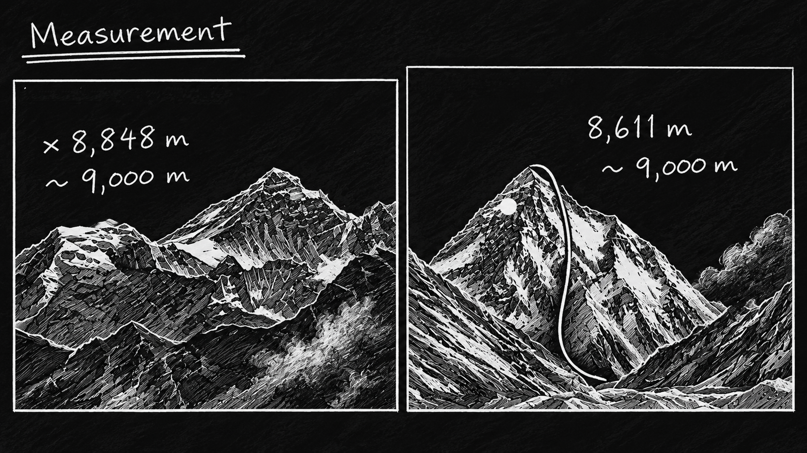
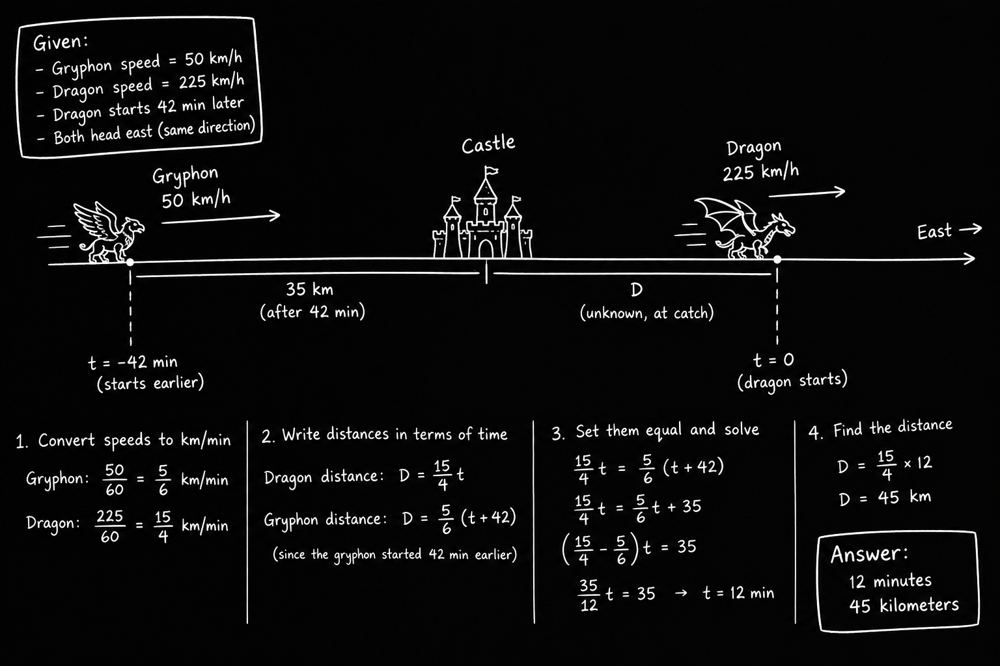

## Work with Units( Measurements-Report, Convert-Units )

> Units and Measurements

### واحد های اندازه گیری

همه میدونیم که برای اندازه گیری هر کمیت واحد های اندازه گیری مختلفی وجود دارن، برای مثال برای اندازه گیری کمیت طول مقدار ها رو با واحد های مختلفی مثل (میلی متر، سانتی متر، متر و ...) نشون میدیم.

حالا فرض کنید که میخوایم همون کمیت طول رو از کیلومتر به متر تبدیل کنیم، حالا توی این شرایط خیلی ساده با یه معادله جبری کوچیک میتونیم خروجی که میخوایم رو بگیریم.

$$ m \rightarrow km $$

#### فرمول جبری تبدیل کیلومتر به متر:

$$ m = \frac{m}{km}\cdot km $$

که بخوایم عددی بنویسیمش میشه:

$$ m = \frac{1000m}{1km}\cdot 1km $$

و بعد از ساده سازی برامون مقدار m باقی میمونه:
$$ 1000m $$

اگر هم برعکس این قضیه رو بخوایم ینی از مت کیلومتر رو بدست بیاریم خیلی ساده مقدار کسر رو معکوس می کنیم که میشه:

$$ km = \frac{km}{m}\cdot m $$

### سوال: حالا میخوایم فاصله رو بدست بیاریم برای این کار نیاز به دو کمیت سرعت و زمان نیاز داریم.

$$ d = r \cdot t $$

### :مثال اول
$$ r = 5 \frac{m}{s} $$
$$ t = 10s $$

حالا بریم برای حل: 
$$d = 5 \frac{m}{s} \cdot 10s$$
$$d = 50m $$
---

### مثال دوم:

$$ r = 5 \frac{m}{s} $$
$$ t = 1h $$

حالا بریم برای حل:

$$ d = 5 \frac{m}{s} \cdot 1h $$
$$ d = 5 \frac{m}{s} \cdot 1h \cdot \frac{3600 \cdot s}{1 \cdot h} $$
$$ d = 18.000m $$

حالا اگر از ما کیلومتر بخوان چی؟؟؟

$$ 18.000m\cdot\frac{1km}{1000m} = 18km $$
---

### مثال سوم: 
حالا یکمی پیچیده تر کنیم قضیه رو، این دفعه فرض کنید به ما فاصله(d) و زمان(t) رو دادن و ازمون سرعت(r) رو میخوان، و همچنین کمیت نهایی رو با واحد متر بر ثانیه میخوان.

$$ d = 150km $$
$$ t = 3h $$

چون کمیت d با ضرب دو کمیت r و t بدست میاد میتونیم رابطه رو به این شکل بنویسیم:

$$ r = \frac{d}{t} $$
$$ r = \frac{150km}{3h} $$
$$ r = 50\frac{km}{h} \Rightarrow 50\frac{km}{h} \cdot \frac{1000 \cdot m}{1 \cdot km} = 50.000\frac{m}{h} $$

$$ r = 50\frac{km}{h} \Rightarrow \frac{50}{1}\frac{km}{h} \cdot \frac{1}{3600}\frac{h}{s} = \frac{1}{72} \cdot \frac{1000m}{72s} \approx 13.9\frac{m}{s}  $$
---

### سوال 2: حالا یه جدول داریم میخوایم بر اساس اون حرکت هایی که شرکت انجام(Input) چه خروجی هایی دریافت می کنه(Output)

$$ Input \rightarrow f(x) \rightarrow Output $$

حالا برای مثال ازمون سوال میپرسن که کدوم شرکت بیشتر از اون یکی فعال تره، اما همینطوری نمیتونیم چشمی و حدسی بگیم که شرکت A از B فعال تره.

|| Corporation A | Corporation B | Input / Output |
| :--- | :---: | :---: | :---: |
| Number of writers | 5 | 11| Input |
| Number of posts posted | 110 | 200 | Output |
| Average number of words of post | 100 | 170 | Output |
| Average likes per post | 3500 | 3500 | Output |
| Average comments per post | 500 | 450 | Output |
| Number of new subscribers | 9000 | 20000 | Output |
| Revenue | $30,000 | 75,000 | Output |
| Expeses | $20,000 | $47,000 | Input |
| Profit (Revenue - Expenses) | $10,000 | $28,000| Output |

فرض کنید میخوایم ببینیم کارمند های کدوم شرکت بیشتر فعالیت دارن، تعداد کارمند ها ستون (Number of writers) و ستون تعداد پست ها (Number of postes posted)، حالا با این اطلاعات میتونیم تعداد پست های هر نفر توی شرکت A, B رو بدست بیاریم.

$$ productivity\frac{posts}{writers} = \frac{posts}{writers} $$
$$ A_{productivity} = \frac{110posts}{5writers} \Rightarrow 22\frac{posts}{writers} $$
$$ B_{productivity} = \frac{200posts}{10writers} \Rightarrow 20\frac{posts}{writers} $$
$$ A_{productivity} > B_{productivity} $$

پس کارمند ها و نویسنده های شرکت A از شرکت B فعالیت بیشتری دارن.
حالا فرض کنید میخوایم سود هر کارمند و نویسنده رو دراریم.

$$ profit\frac{profit}{witers} = \frac{profit}{witers}  $$
$$ A_{profit} = \frac{\$10,000}{5writers} \Rightarrow \$2,000\frac{profit}{writers} $$
$$ B_{profit} = \frac{\$28,000}{10writers} \Rightarrow \$2,800\frac{profit}{writers} $$

---

سوال 3: فرض بکنید یک استخر بادی داریم که به شکل استوانه ای هست، که مساحت کف اون 4 متر مربع و ارتفاع اون 60 سانتی متر هست.

حالا ازمون حجم این استخر رو میخوان، به همراه متر مکعب.

$$ V = b \cdot h $$

نمی تونیم مستقیم بیایم و بگیم V = 4 * 60 = 240m^3 چون واحد های cm و m یکی نیستن. پس باید اول تبدیل واحد انجام بدیم.

$$ V = 4m^2 \cdot \frac{60}{100} = \frac{240}{100}m^3 = 2.4m^3 $$

---

سوال 4: سارا و مارتین هر کدوم یک گل دارن خونشون، سارا میانگین رشد گلش 2 سانتی متر در هفته است، مارتین هم میانگین رشد گلش را اندازه گرفته و به مقدار 3 میلیمتر در هر روز دست یافته اشت، حالا گیاه یا گل کی زودتر رشد میکنه؟؟؟

$$ Sara = 2\frac{cm}{week} $$
$$ Martin = 3\frac{mm}{day} \Rightarrow 3\frac{mm}{day} \cdot 7\frac{day}{week} \Rightarrow 21\frac{mm}{week} \cdot \frac{1 \cdot cm}{10 \cdot mm} = 2.1cm $$
---

> Measurements-Report

### گزارش واحد ها، دقت در اندازه گیری مقدار کمیت ها

اگر بخواهیم یک چرخ دنده را برای یک گردنبند تزیینی اندازه بگیریم خیلی اهمیتی به ممیز ها و مقادیر خورده ای توجه نمی کنیم و برای مثال اندازه ی آن را تقریبی 3cm تخمین می زنیم، اما اگر آن قطعه را به جای اینکه با یکی خط کش معمولی تخمین بزنیم با یک خط کش مهندسی اندازه آن را تخمین می زنیم حالا به عدد 3.1cm می رسیم، و بار بعدی اندازه ی آن را با یک میکروسکوپ تخمین می زنیم و به عدد 3.089182cm می رسیم. شاید برای یک گردنبند همان تخمین 3cm کافی باشد اما فرض کنید که این قطعه را برای یک ماشین مکانیکی کارخانه می خواهیم باید دقت تخمین تا اندازه ای باشد که ماشین مکانیکی دچار نقص یا خطا شود، شاید همان 3.08 کافی باشد، حالا فرض بکنید که این چرخ دنده یکی از قطعات بنیادی یک شاتل فضایی است که باید تخمین ما بسیار دقیق تر از قبل باشد و تخمین 3.089182cm کافی باشد تا سیستم دچار مشکل نشود، همه ی این موارد به ما نشان می دهد اندازه ی قطعات مساحت صفحات و ... باید با توجه به نوع کاربرد آن قطعه در نظر گرفته شود.

    

تصویر تخمین تقریبی کوه اورست و کوه k3

---

سوال 5: یک گریفون از بالای قلعه به سمت شرق در حال حرکته، سرعت اون 50km/h، 42 دقیقه بعد از اون یک اژدها هم از بالای قلعه در حال حرکت به سمت شرقه این اژدها با سرعت 225km/h پرواز میکنه. فرض کنید که اژدها و گریفون به مسیرشان به همان سرعت ادامه می دهند. حالا می خواهیم بدانیم چند دقیقه طول خواهد کشید تا اژدها به گریفون برسد؟؟؟

$$ d = r \cdot t  $$

$$ dragon = 225\frac{km}{h} \cdot t \cdot min \cdot \frac{1 \cdot h}{60 \cdot min} \Rightarrow \frac{225km}{60min} \cdot t $$

$$ gryphon = 50\frac{km}{h} \cdot (t+42) \cdot min \cdot \frac{1 \cdot h}{60 \cdot min} \Rightarrow \frac{5km}{6min} \cdot (t + 42)$$

$$ \frac{225}{60} \cdot t = \frac{50}{60} \cdot (t + 42) $$
$$ \frac{225}{60} \cdot t = \frac{50}{60} \cdot t + 35 $$
$$ (\frac{225}{60} - \frac{50}{60}) \cdot t = 35$$
$$ \frac{175}{60} \cdot t = 35 $$
$$ t = 35 \cdot \frac{60}{175} $$
$$ t = 12min $$

    

