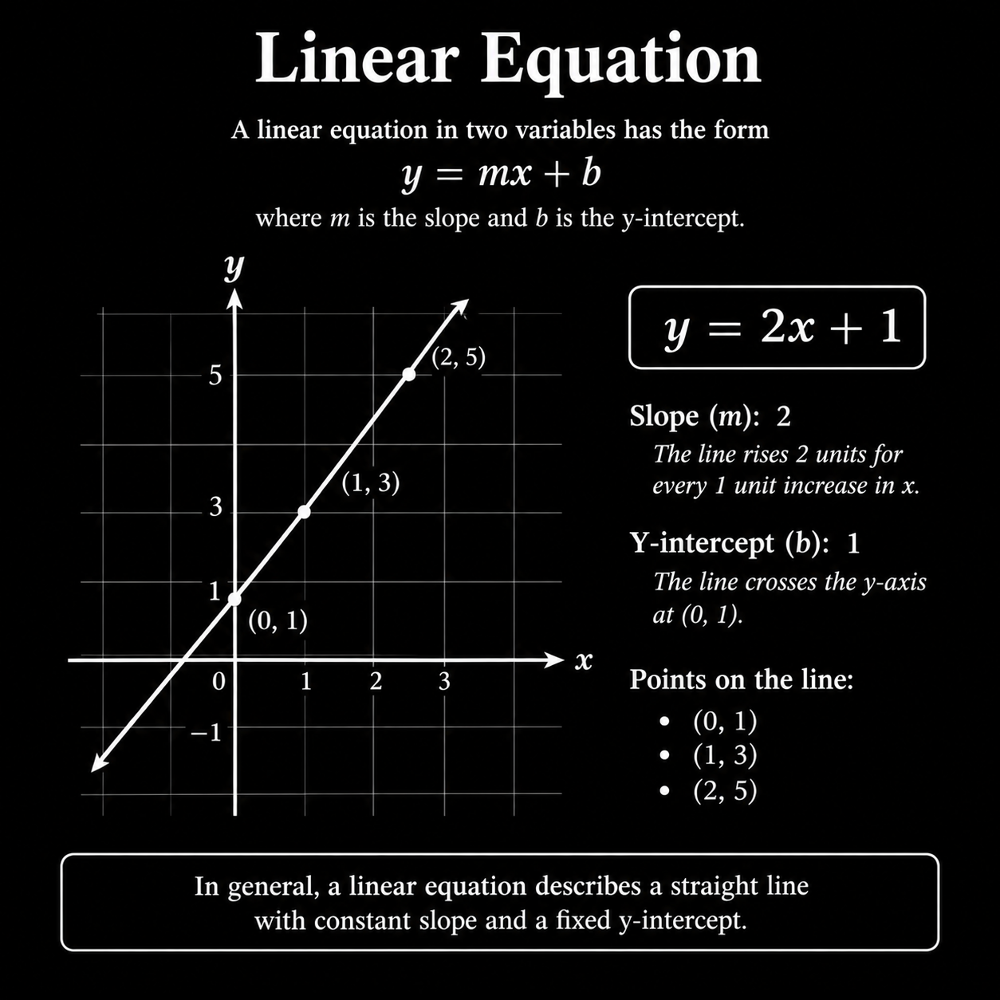
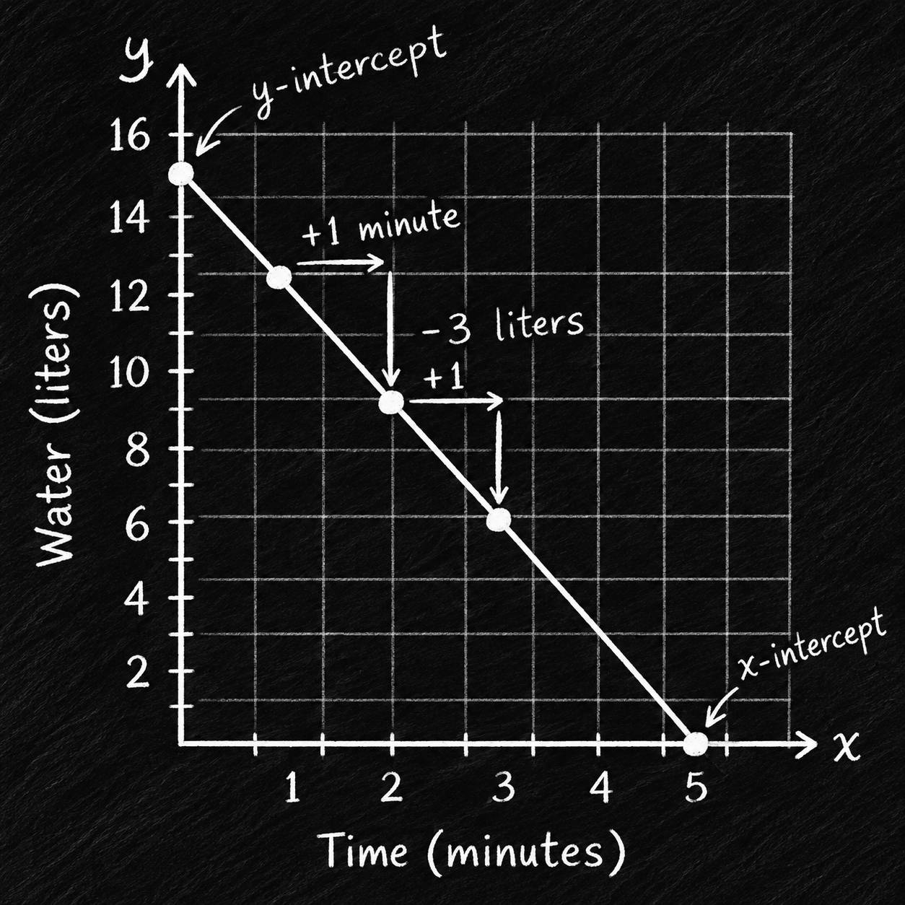
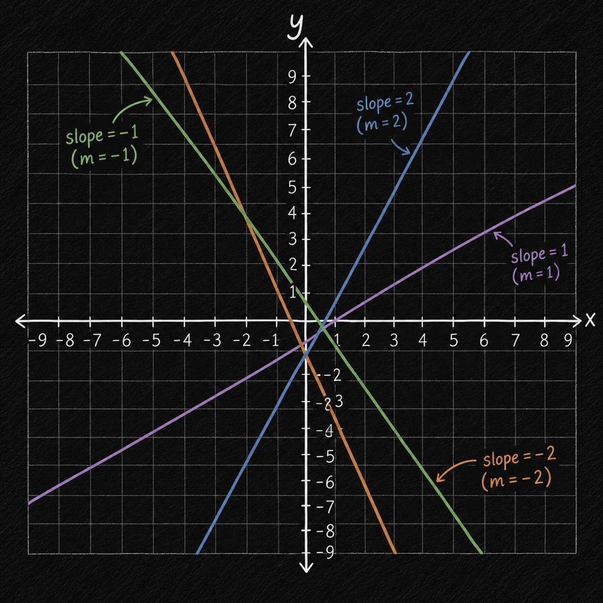
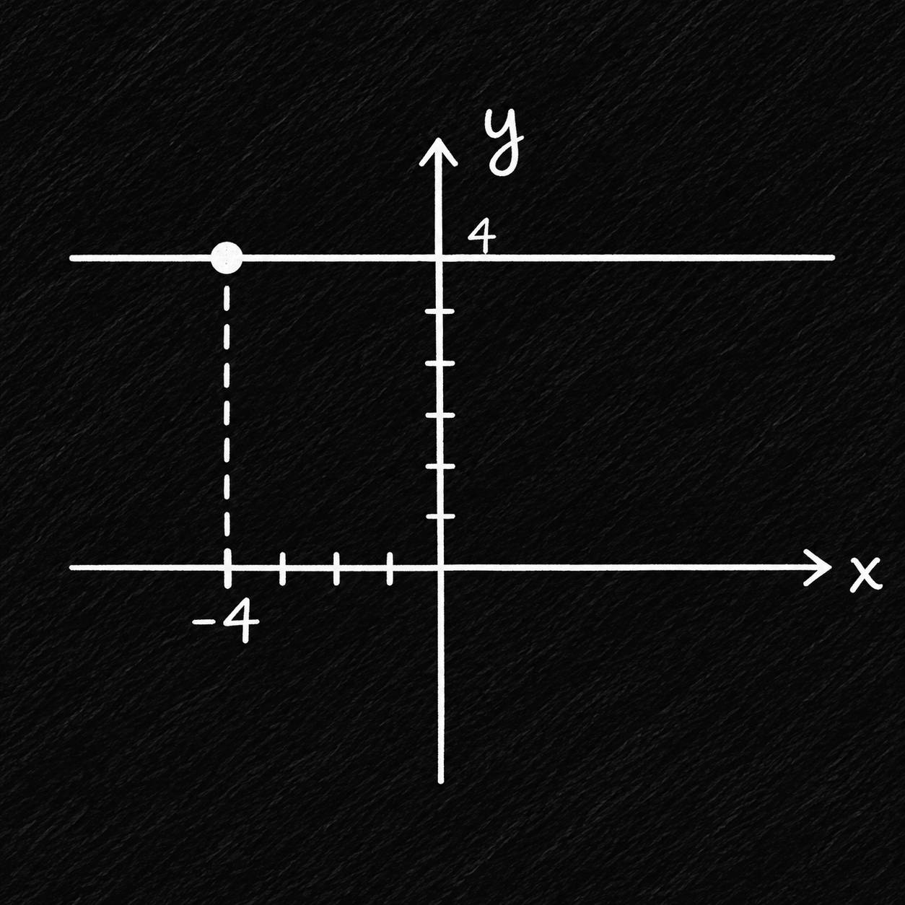

## 60-80: Linear Equations(Slope, Intercepts, Coordinates)

### معادلات خطی | Linear Equations:
معادلات خطی از آن دسته معادلاتی هستند که با تفییر یک مقدار(x) مقدار دیگر (y) به مقدار مشخص و ثابتی تغییر می کند، در عکس پایین یک نمونه از معادلات خطی رو ببینید. این شکل معادلات یکی از پایه ای ترین معادلات دنیای جبر و ریاضی است، و کاربرد گسترده ای در جهان داره، به همین دلیل درک اون بسیار اهمیت داره!!!
 
- به طور کلی یک معادله ی خطی یک خط با یک شیب ثابت رو ایجاد میکنه که همه ی نقاط مختص اون عبارت روی خط قرار می گیرن.

    

در این معادلات اگر مقدار x را تغییر دهید مقدار y شما روی خط خواهد قرار گرفت.
برای مثال اگر مقادیر تصویر بالا را درون یک جدول قرار دهیم به این شکل در می آید که با تغییر یک x مقدار y دو واحد افزایش پیدا می کند.

| x | y | equation |
| :---: | :---: | :---: |
| 0 | 1 | $ y = 2(0) + 1 $ | 
| 1 | 3 | $ y = 2(1) + 1 $ |
| 2 | 5 | $ y = 2(2) + 1 $ |
| 3 | 7 | $ y = 2(3) + 1 $ |
| $ x_{perv}+1 $ | $ y_{perv}+2 $ | $ y = 2x + 1 $ |

---

### معادلات غیر خطی | Non-Linear Equations(Polynomial):
این دسته معادلات بر خلاف اینکه یک خط با شیب ثابت را ایجاد کنن، به جاش یه منحنی(convex) ایجاد میکنن به خاطر همین دیگه شیب ثابت نیست و متغیر هست، یک مثال توی دنیای واقعی بخوایم بزنیم نمودار رشد قد و سن میتونه مثال خوبی باشه.

چند نمونه از عبارات غیرخطی:

$$ y = x^2 $$
$$ xy = 12 $$
$$ x^2-y^2 = -2 $$

فعلا خیلی نمیخوایم روی معادلات غیرخطی تمرکز کنیم، پس به عنوان تعریف بشناسیدش.

---

### سوال 1:
علی بعد از حموم دریچه وان حموم رو باز کرد تا آب خالی بشه، شکل زیر رابطه ی بین مقدار آب توی وان (liter) با زمان (minute) رو نشون میده، فرض بکنید که خالی شدن آب از وان در واحد زمان ثابت است.

    

1. تا قبل از اینکه علی دریچه تخلیه آب را باز بکند چه مقدار آب توی وان بود؟
برای این سوال باید ببینیم که خط محور y را در چه مقداری قطع می کند. که میشود: 15liter
$$ y_{intercept} = 15liter $$

2. هر یک دقیقه چه مقدار آب تخلیه می شود؟ و همینطور هر دو دقیقه چقدر؟
هر یک دقیقه 3 لیتر آب تخلیه می شود و هر 2 دقیقه 6 لیتر.
$$ draining_{1minute} = 3\frac{liters}{minutes} $$
$$ draining_{2minute} = 6\frac{liters}{minutes} $$

3. چقدر طول می کشه تا وان کامل خالی و خشک بشه؟
برای این سوال باید مقداری که خط محور x رو قطع میکنه رو قرار بدیم.
$$ x_{intercept} = 5minutes $$

---

### شیب خط | Slope of Line:
این همه گفتیم شیب خط در معادلات خطی یکسانه، حالا ببینیم اصلا یعنی چی، شیب خط مشخص میکنه که یک مقدار با چه سرعت و جهتی داره افزایش یا کاهش پیدا میکنه. پس میشه ازش فهمید که شیب خط هرچی بیشتر باشه مقدار y حساس تر میشه به تغییرات x, با دونستن شیب خط میشه فهمید هر مقدار کجا قرار میگیره.

    

برای اینکه شیب خط رو بدست بیاریم نیاز به حداقل دوتا مختصات داریم، و با این دوتا میشه جهت و سرعت شیب رو بدست آورد. با عبارت پایین میشه شیب خط رو بدست آورد.

$$ slope = \frac{y_{2} - y_{1}}{x_{2} - x_{1}} $$

شاید این عبارات رو هم جاهای دیگه ببینید، اما مفهوم همونه فقط شکل عبارت تغییر کرده.

$$ slope = \frac{rise}{run} = \frac{\Delta y}{\Delta x} = m = \frac{y_{2} - y_{1}}{x_{2} - x_{1}} $$

همچنین برای فهم ساده تر میتونین این عبارت رو به شکل زیر ببینید:

$$ slope = \frac{change_y}{change_x} $$

حالا بیاید شیب خط جدول زیر رو بدست بیاریم، با توجه به فرمول و عبارت های بالا باید نرخ تغییر مختصات اول رو با مختصات دوم بدست بیاریم. و چون در معادلات خطی هستیم میتونیم هر دو نقطه ای که میخوایم رو انتخاب کنیم.

| $x$ | 2 | 3 | 4 | 5 | 
| :-: | :-: | :-: | :-: | :-: | 
| $x$ | 4 | 1 | -2 | -5 | 

$$ \frac{y_{2} - y_{1}}{x_{2} - x_{1}} = \frac{4 - 1}{2 - 3} = \frac{3}{-1} = -3 $$

و حتی جابه جایی تاثیری روی شیبی که بدست میاریم نداره

$$ \frac{y_{2} - y_{1}}{x_{2} - x_{1}} = \frac{1 - 4}{3 - 2} = \frac{-3}{1} = -3 $$

اما وقتی جابجایی انجام میدیم از یک مختصات به یه مختصات دیگه میریم.

$$ (3, 1) \rightarrow (2, 4) = \frac{3}{-1}$$
$$ (2, 4) \rightarrow (3, 1) = \frac{-3}{1}$$

---

### سوال 2:

کایا با دوچرخه اش به سمت درخت با سرعتی در حال حرکت هست، در جدول زیر رابطه بین فاصله با درخت و تعداد چرخش چرخ دوچرخه را نشان می دهد.

| Tire Rotations [$x$]| Distance to tree (m) [$y$] |
| :-: | :-: |
| 4 | 22.5 |
| 8 | 12.5 |
| 12 | 2.5 |

1. کایا قبل از اینکه با دوچرخه اش شروع به حرکت کردن بکند چقدر با درخت فاصله داشته است؟
برای این سوال میتونیم مقدار محور تقاطع فاصله(y) که عمودی هست رو بدست بیاریم، اما همونطور که توی جدول میبینید ما به مقدار فاصله(y) در چرخش(x) -> 0 نیاز داریم.

| Tire Rotations [$x$]| Distance to tree (m) [$y$] |
| :-: | :-: |
| 0 | ? |

اگر به جدول دقت کنید می بینید که با افزایش هر 4 واحد از محور چرخش چرخ مقدار محور فاصله 10 واحد کاهش پیدا می کند. پس اگر: 

$$ 4 - 4 = 0 \Rightarrow x = 0 $$
$$ 22.5m + 10m =32.5m \Rightarrow y = 32.5 $$

2. توی هر یک بار چرخش چرخ کایا چند متر را طی میکند؟

$$ \frac{10m}{4} = 2.5m $$

---

### شیب خط 0:
اگر عبارت خطی ما به گونه ای باشد که با تغییر مقدار x مقدار y تغییری رو شامل نشه میتونیم بگیم این معادله خطی شیبش برابر با 0 است.

    

$$ y = 4 $$

---

### شیب خط تعریف نشده | Undefined Slope:
اگر خط ما به صورت عمود و قائم باشد می توانیم بگوییم شیب خط آن تعریف نشده است.

$$ x = 5 = Undefined $$

---

### محور های تقاطع | Intercept's: 

محور های تقاطع نقاطی هستند که یکدیگر را قطع می کنند، وقتی میگوییم محور تقاطع x منظورمان همان نقطه ای است که خط با محور x برخورد می کند. و برای y هم همین قضیه صدق می کند، با این تفاوت که محور y یک محور عمودی است و x افقی.

محور تقاطع x:
$$ (x, 0) \Rightarrow Y_{intercept} $$

محور تقاطع y:
$$ (0, y) \Rightarrow X_{intercept}  $$

### سوال 3: 
با توجه به جدول پایین که نقاط (x, y) روی گراف معادله ی خطی نشان می دهد، مقدار y_intercept رو مشخص کنید

| x | y |  |
| :---: | :---: | :---: |
| -2 | 8 |
| 1 | 2 |
| 2 | 0 | $ \rightarrow X_{intercept} $|
| 4 | -4 |

$$ \frac{ \Delta y }{\Delta x} = \frac{-2}{1} = \frac{-4}{2} = -2 $$
$$ (-1, 6) \Rightarrow (-1 + 1, 6 - 2) \Rightarrow (0, 4)$$

| x | y |  |
| :---: | :---: | :---: |
| 0 | 4 | $ \rightarrow Y_{intercept} $ |

---

### سوال 4: 
برای معادله ی زیر X_intercept را مشخص کنید، برای مشخص کردن محور تقاطع X باید مقدار y را 0 قرار دهیم و حل کنیم.

$$ 2y + 3x = 7 $$

حل:

$$ y = 0 \rightarrow (x, 0) $$
$$ 2(0) + 3x = 7 $$
$$ 3x = 7 $$
$$ x = \frac{7}{3} \Rightarrow 2\frac{1}{3} $$

---