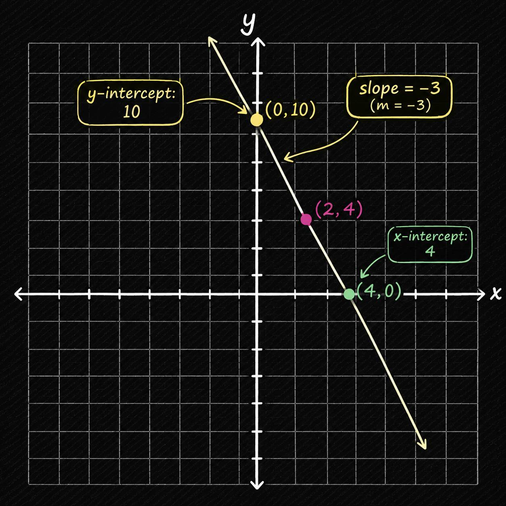

## 80-100: Write Linear Equations with Different Forms, Linear System

### نوشتن معادلات خط | Write the Linear Equation:

در فهرست قبل فهمیدیم چطور شیب و عرض از مبدا رو از یک معادله ی خطی از قبل نوشته شده بفهمیم، حالا میخوایم با استفاده و با همراه داشتن شیب و عرض از مبدا یک معادله ی خط رو در فرم slope-intercept بنویسیم.

فرم slope-intercept رو یادمونه:

$$ y = mx + b $$

در این معادله متغیر m بیان کننده شیب خط است و متغیر b بیان کننده ی عرض از مبدا است. پس برای نوشتن معدله ی خط در این فرم و فاکتور باید مقادیر m و b رو بدست بیاریم.

 

فرض کنید که شیب خط ما -3/4 و از نقطه ی (0, 8) رد میشه، حالا معادله ی خط اون رو در فاکتور slope-intercept بنویسید.

$$ slope = \frac{-3}{4} $$

$$ m = (0, 8) $$

$$ y = mx + b $$

$$ y = \frac{-3}{4}x + 8 $$

حالا فرض کنید مستقیم بهمون شیب و عرض از مبدا رو ندادن و بجاش بهمون دوتا نقطه رو دادن، ناامید نشید خیلی ساده میشه حلش کرد.

معلومات مسئله:

$$ (x_1, y_1) = (6, -1) $$

$$ (x_2, y_2) = (-4, 5) $$

فرمول بدست آوردن شیب:

$$ m = \frac{ \Delta y }{ \Delta x } = \frac{ y_2 - y_1 }{ x_2 - x_1 } $$

حالا بریم شیب رو بدست بیاریم:

$$ \frac{ -4 - 6 }{ 5 - (-1) } = \frac{-10}{6} \Rightarrow m = \frac{-5}{3} $$

حالا شیب رو داریم، بریم عرض از مبدا رو بدست بیاریم. با یکی از نقطه ها که داریم:

$$ 6 = \frac{-5}{3}(-1) + b $$

$$ 6 - \frac{5}{3} = b $$

$$ \frac{18}{3} - \frac{5}{3} = b $$

$$ b = \frac{13}{3} $$

$$ (0, b) \rightarrow Y_{intercept} $$

پس با جایگزینی، معادلمون میشه:

$$ y = \frac{-5}{3}x + \frac{13}{3} $$

### سوال 1:

تارا داشت کوه نوردی میکرد، اون از ارتفاع 1200 متری شروع به بالا رفتن کرد، سرعت بالا رفتن اون رو ثابت فرض کنید. بعد از 4 ساعت اون به ارتفاع 1700 متری رسید. معادله ی آن را بدست آورید.

- مقدار y نشان دهنده ی بالا رفتن در واحد متر است، و x نشان دهنده ساعت است

$$ slope = \frac{1700m - 1200m}{4hours} = 125\frac{m}{hours} $$

$$ y = 125x + 1200 $$

---

### فرم نقطه و شیب | Point-Slope Form:

در این فرم معادله ی ما متفاوت تر از فرم slope-intercept است. همونطور که از اسمش پیداست از دوتا نقطه میتونیم این فرم از معادله ی خطی رو بنویسیم. بریم و حالت abstract این معادله رو بنویسیم.

$$ slope = \frac{ \Delta y }{ \Delta x } = \frac{y_2 - y_1}{x_2 - x_1} = m $$

$$ (x_2 - x_1) \cdot \frac{y_2 - y_1}{x_2 - x_1} = m \cdot (x_2 - x_1) $$

$$ y_2 - y_1 = m \cdot (x_2 - x_1)$$

حالا اگر شیب خط و نقطه ی اول رو با این اعداد داشته باشیم میتونیم این معادله رو به شکل slope-intercept ساده کنیم.

$$ m = 2 $$

$$ (x_1, y_1) = (-7, 5) $$

حالا بریم بنویسیمش:

$$ y_2 - 5 = 2(x_2 - (-7)) $$

$$ y_2 - 5 = 2x + 14 $$

$$ y_2 - 5 = 2x + 14 $$

$$ y = 2x + 19 $$

### سوال 2:

با دوتا نقطه ی زیر معادله خطی را با دو فرم slope-intercept و point-slope بنویسید.

 

معلومات مسئله:

$$ (x_1, y_1) = (4, 9) $$
$$ (x_2, y_2) = (6, 1) $$

حل مسئله:

$$ slope = \frac{1 - 9}{6 - 4} = \frac{-8}{2} = -4 $$

$$ \frac{y_2 - 9}{x_2 - 4} = -4 $$

$$ (x_2 - 9) \cdot \frac{y_2 - 4}{x_2 - 9} = -4 \cdot (x_2 - 9) $$

$$ y_2 - 9 = -4(x_2 - 4) $$

حالا بریم تبدیلش کنیم به slope-intercept:

$$ y - 9 = -4(x_2 - 4) $$

$$ y - 9 = -4x + 16 $$

$$ y = -4x + 25 $$

---

### فرم استاندارد | Standard Form:

حالا بریم برای اینکه با یه فرم جالب دیگه از معادلات خطی آشنا بشیم. توی فرم استاندارد خیلی راحت میشه مقادیر محور تقاطع x و y رو بدست آورد و یکی از مزیت های اصلی اش اینه، ولی برای اینکه این رو به به سایر فرم ها بنویسیم باید شیب خط رو بدست بیاریم. 

$$ Ax + By = C $$

بریم برای مثال زیر محور های تقاطع رو پیدا کنیم. اول برای y

$$ 9x + 16y = 72 $$

$$ 9(0) + \frac{16y}{16} = \frac{72}{16} = 4.5 $$

$$ Y_{intercept} = (0, 4.5) $$

حالا بریم برای x رو بدست بیاریم:

$$ 9x + 16y = 72 $$

$$ \frac{9x}{9} + 16(0) = \frac{72}{9} = 8 $$

$$ X_{intercept} = (8, 0) $$

حالا برای اینکه به فرم slope-intercept تبدیلش کنیم از این دو محور تقاطع برای بدست آوردن شیب خط میتونیم استفاده کنیم.

$$ \frac{4.5 - 0}{0 - 8} = \frac{4.5}{-8} = \frac{9}{-16} $$

$$ \frac{16y}{16} = \frac{-9x}{16} + \frac{72}{16} $$

$$ y = \frac{9}{-16}x + 4.5 $$

### سوال 3:

خط معادله ی خطی زیر راپیدا کنید

$$ 5x + 2y = 20 $$

$$ \frac{2y}{2} = \frac{20 - 5x}{2} $$

$$ y = 10 - \frac{5}{2}x $$

$$ y = 10 - \frac{5}{2}(0) = 10 \rightarrow (0, 10) $$

$$ y = 10 - \frac{5}{2}(2) = 5 \rightarrow (2, 5) $$

$$ y = 10 - \frac{5}{2}(4) = 0 \rightarrow (4, 0) $$

    

### :سوال 4

معادله های زیر را حل کنید (از فرم point-slope به slope-intercept):

#### اولین معادله:

$$ y + 2 = -2(x-3) $$

$$ y + 2 = -2x + 6 $$

$$ y = -2x + 4 $$

#### دومین معادله:

$$ -4x + 7 = 2y - 3 $$

$$ -4x + 10 = 2y $$

$$ \frac{-4x}{2} + \frac{10}{2} = \frac{2y}{2} $$

$$ -2x + 5 = y $$

#### سومین معادله:

$$ -3x + 5y = 2x + 3y $$

$$ 5y = 5x + 3y $$

$$ 2y = 5x $$

$$ \frac{2y}{2} = \frac{5x}{2} $$

$$ y = \frac{5x}{2} $$

### سوال 5:

یه خط از روی نقطه های زیر عبور می کنند. معادلات خط را به سه فرم بنویسید.

 

معلومات مسئله:

$$ (x_1, y_1) = (-3, 6) $$
$$ (x_2, y_2) = (6, 0) $$

حل:

$$ slope = \frac{0 - 6}{6 - (-3)} = \frac{-6}{9} = \frac{-2}{3} $$

point-slope:

$$ y - 6 = \frac{-2}{3}(x - (-3)) $$

slope-intercept:

$$ y - 6 = \frac{-2}{3}(x - (-3)) $$

$$ y - 6 = \frac{-2}{3}x -2 $$

$$ y = \frac{-2}{3}x + 4 $$

standard-form:

$$ y = \frac{-2}{3}x + 4 $$

$$ \frac{2}{3}x + y = 4 $$

$$ 2x + 3y = 12 $$

---

### دستگاه های معدلات خطی | System of Linear Equation:

توی دستگاه های معادله ی خطی بجای اینکه فقط یک معادله داشته باشیم چند معادله رو داریم که باید اونها رو به صورت هم زمان مقادیرش رو بدست بیاریم. هدف ما پیدا کردن مقادیری برای متغیرهاست که تمام معادلات را درست کنند.

$$ \begin{cases} x + y = 10 \\ x - y = 6 \end{cases} $$

پس اگر مقادیر رو برابر با مقادیر زیر قرار بدیم:

$$ x = 8,\ y = 2 $$

مقادیر درست بدست میان.